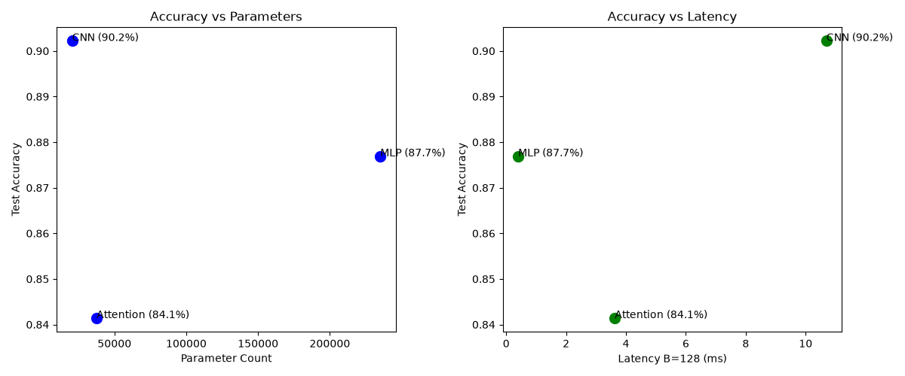

# Lab 3: Architectures and Their Costs

## 1. Summary of Experiments

In this lab, I implemented and evaluated three different PyTorch architectures (MLP, CNN, and a Patch-based Transformer) on the Fashion-MNIST dataset. All models were trained for 5 epochs using Adam optimizer with a learning rate of 1e-3 and batch size of 128.

Below are the collected metrics regarding parameter count, measured FLOPs/MACs, inference latency for batch sizes 1 and 128, and final test accuracy:

| Architecture | Parameters | FLOPs / MACs (thop) | Latency B=1 (ms) | Latency B=128 (ms) | Test Accuracy |
|--------------|------------|---------------------|------------------|--------------------|---------------|
| MLP          | 235,146    | 234,752             | 0.061            | 0.400              | 87.69%        |
| CNN          | 20,490     | 1,031,744           | 0.191            | 10.693             | 90.22%        |
| Attention    | 37,514     | 591,488             | 0.367            | 3.625              | 84.14%        |

---

## 2. FLOPs Calculations and Profiling Differences

### Hand Calculations (1 sample)

* **MLP (Linear Layer 784 -> 256):**
  $$\text{FLOPs} = 2 \times 784 \times 256 = 401,408$$

* **CNN (First Conv2d Layer: 1 -> 16, kernel 3x3, output 28x28):**
  $$\text{FLOPs} = 2 \times 3 \times 3 \times 1 \times 16 \times 28 \times 28 = 225,792$$

* **Attention (QKV Projections in 1 Encoder Layer, seq_len=16, d_model=64):**
  $$\text{FLOPs} = 2 \times 16 \times 64 \times (3 \times 64) = 393,216$$

### Why hand calculations differ from `thop`
Profiling libraries like `thop` mainly focus on counting Multiply-Accumulate (MAC) operations in Linear and Conv2d layers. They usually skip non-linear activations (ReLU), pooling operations (MaxPool2d), Softmax calculations, and LayerNorms. Because of this, manual FLOP counts based on full mathematical formulas don't match the profiler's raw MAC output perfectly.

---

## 3. Trade-off Analysis & Architectural Costs

Looking at the plots and table above, we can draw a few key conclusions:

1. **CNN:** Shows the best overall accuracy (90.22%) while using by far the fewest parameters (only ~20k). The parameter efficiency comes from weight sharing and spatial locality across the 2D feature maps. The trade-off is higher FLOPs and increased latency at batch size 128 compared to MLP, as sliding 2D kernels across all channels requires more sequential compute steps.

2. **MLP:** Achieved 87.69% accuracy but required 235k parameters — over 10 times more than the CNN. Since fully connected layers do not reuse weights across spatial dimensions, they suffer from low arithmetic intensity and higher memory usage. However, because the operations are straightforward matrix multiplications, it ran with the lowest latency (0.400 ms at B=128).

3. **Attention:** Reached 84.14% accuracy with 37.5k parameters. Dividing a 28x28 image into 16 patches (7x7) allows self-attention to capture global context, but on small datasets like Fashion-MNIST without pre-training, it lacks the strong inductive bias that CNNs have. Additionally, the QKV matrix projections and attention score computation add computational overhead, resulting in higher single-sample latency (0.367 ms).

### Conclusion
For Fashion-MNIST classification, the **CNN architecture is the most cost-effective choice**. It delivers the highest accuracy per parameter by taking advantage of spatial inductive bias, making it much more memory-efficient than an MLP and more accurate than a Transformer of comparable size.